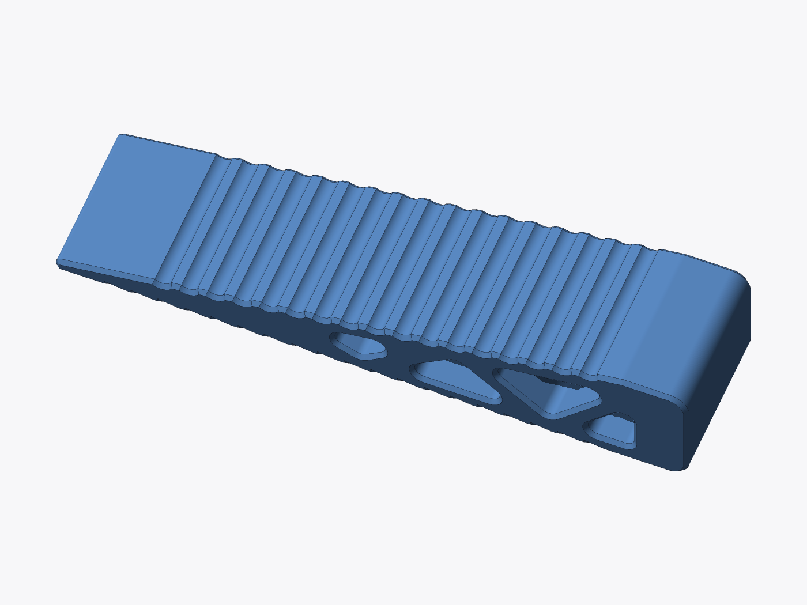
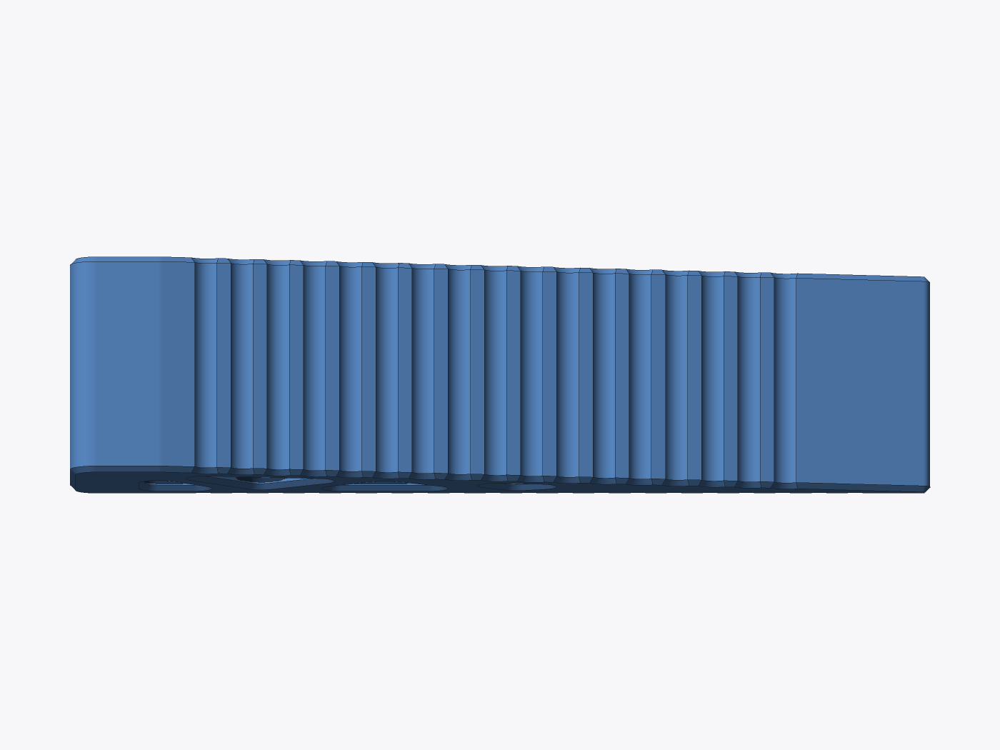

# Door stopper

<p>
  
  
</p>

A 3D-printable door wedge with a Warren truss core, like a bridge, and grip on both faces.
It is fully parametric: one FreeCAD macro holds every dimension and checks the geometry.

## Size

| | mm |
|---|---|
| Length | 95 |
| Heel height | 18 (door gaps up to ~16) |
| Width | 24 |
| Slope | 10.7 deg |
| Volume | 18.9 cm^3 |

## Design

- **Truss core:** two solid 2.4 mm chords (floor and slope) with 3.2 mm diagonals.
  Windows have 1.5 mm corner radii. The first 32 mm at the tip and a 5 mm heel wall stay solid.
- **Floor grip:** 19 small ratchet teeth, 0.4 mm deep, 4 mm pitch. The steep face points
  to the heel, so the teeth bite when the door pushes.
- **Slope grip:** 17 round scallop grooves, 0.6 mm deep, 4 mm pitch. They catch the door
  edge without sharp corners.
- **Edges:** 3 mm fillets at the heel, 0.6 mm chamfers on both flat faces.

## Print

The STL is already in print orientation: the wedge lies **on its side**. Every layer holds
the full truss outline, so kicks and slams load the part along the layers, and the windows
print as vertical holes. No support.

- PETG or ASA for impact. PLA works but is brittle. TPU 95A gives the most grip.
- 5 walls, 30-40 % gyroid infill, 0.4 mm nozzle.

## Build

FreeCAD here is the Flatpak. Pass the macro by absolute path.

```sh
# Dimension checks only, no FreeCAD needed.
python3 build.FCMacro --check

# Full build: writes out/door-stopper.{FCStd,step,stl}.
flatpak run --command=FreeCADCmd org.freecad.FreeCAD "$PWD/build.FCMacro"
```

Change sizes at the top of `build.FCMacro`, not by scaling the STL: scaling changes the
grip depth and truss member width too.

## Downloads

STL, STEP and FCStd are attached to each [release](../../releases).
